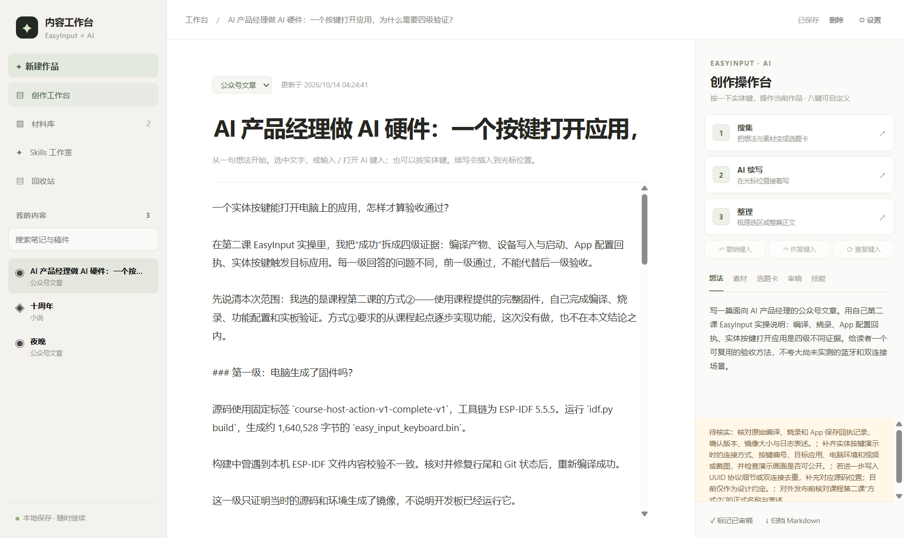
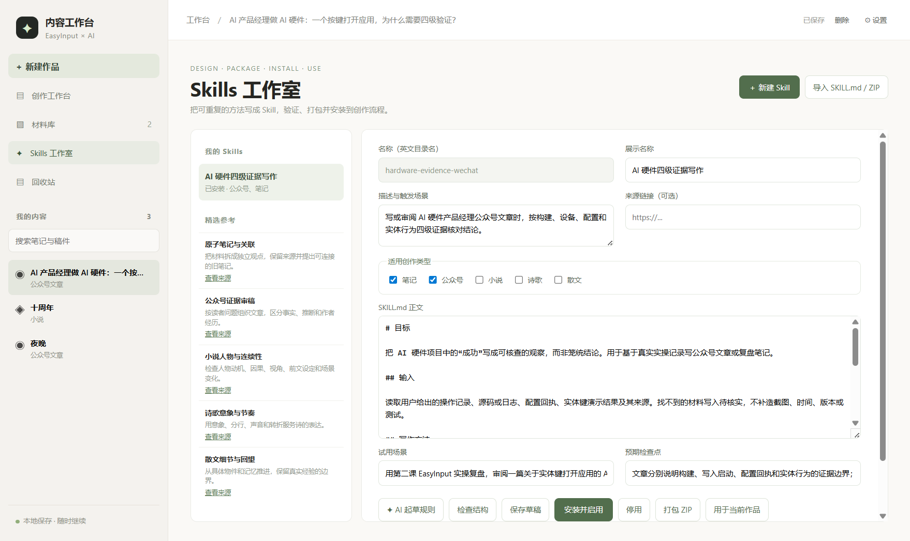
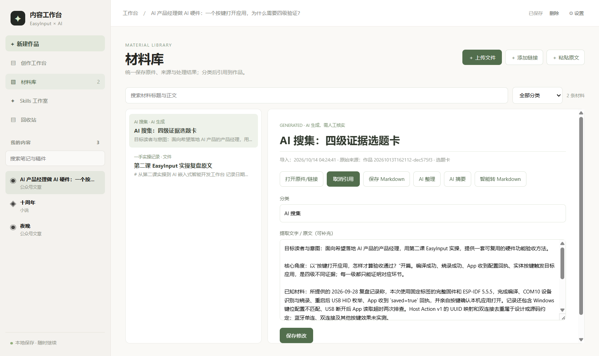
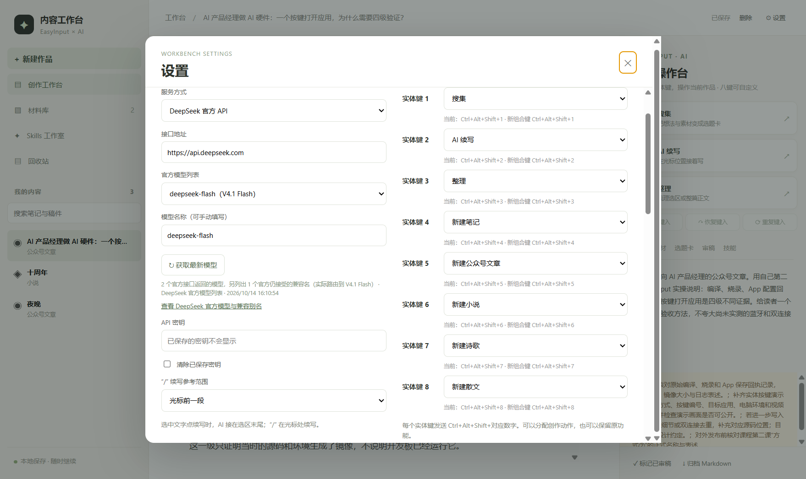
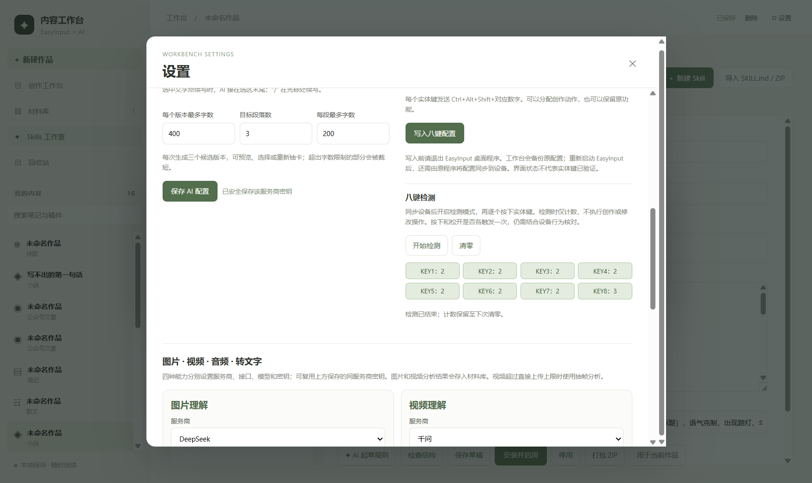

# 第四课作业 AI 内容创作工作台实践报告

**提交状态：真实案例已归档，实体八键已联调；文章仍待作者审稿，连续一周使用记录仍在进行。** 这份报告面向第四课评审，说明我选了什么高频场景，怎样把 EasyInput、Agent、Skill 和本地材料接成工作流程，哪些结果已有证据，以及尚不能声称完成的部分。

## 一 选题与目标

我选的高频场景是每周写一篇面向 AI 产品经理的公众号文章。困难不是“让 AI 写出一段话”，而是课程实践、网页和个人笔记分散在不同位置；每次都要重复说明受众、事实边界和写作要求；生成后还要把来源、待核实项和稿件归档。我因此做了一个本地内容工作台：笔记界面承接输入，材料库保存原文和链接，Skill 保存稳定规则，EasyInput 八个实体键触发常用动作，作者保留选稿与审稿权。

第四课指南要求至少三个快捷按键、一个真实选题跑通流程、可复用 Skill，以及使用后的迭代。它没有要求一个键自动完成全链路，也没有把视频列为统一门槛。我的实现是“多个实体键进入同一条工作流”：KEY1 搜集，KEY2 续写，KEY3 整理，作者确认后归档；其余五键快速创建不同文体。这样既能缩短重复操作，也不会跳过候选稿选择与事实审查。

## 二 工作台怎样运转

| 环节 | 当次输入与动作 | 稳定组件 | 可见产出 |
| --- | --- | --- | --- |
| 灵感采集 | 写一句读者问题，上传复盘文件或贴链接与原文；按 KEY1 搜集 | 材料库、公众号规则、可选 Skill | 来源可追溯的材料记录和选题卡 |
| 内容生成 | 用 KEY2 或 `/` 发起续写；可选选区或光标前文，限制字数和段落 | DeepSeek 官方 API、续写规则 | 三个候选版本，选择一个或重新抽卡 |
| 修改审稿 | 用 KEY3 整理选区或全文；作者核对事实、语气与引用 | 四级证据 Skill、待核实清单、撤销历史 | 修订稿与审稿备注 |
| 素材归档 | 审阅后手动归档，不自动发布 | 本地 Markdown 归档、材料库 | 带来源和待核实状态的文章文件 |

按键里保存的是 `Ctrl+Alt+Shift+1…8` 这组稳定入口。具体的受众、题目、原始材料、字数限制和是否使用某个 Skill 留在当次作品里，而不是写死在设备里。Agent 根据当前作品文体读取内置规则和用户勾选的 Skill。材料仍在本地保存原件、可提取原文、链接和可选 Markdown 副本；网页若需登录或禁止抓取，则只保存链接并让作者补充原文。

| 实体键 | 工作台动作 | 为什么占用这个键 |
| --- | --- | --- |
| KEY1 | 搜集 | 从当前想法和材料生成可核查的选题卡 |
| KEY2 | AI 续写 | 在当前位置给出三版候选，由作者挑选 |
| KEY3 | 整理 | 梳理当前正文或选区，并留下待核实项 |
| KEY4 | 新建笔记 | 快速记录灵感或会议观察 |
| KEY5 | 新建公众号文章 | 进入本次高频写作场景 |
| KEY6 | 新建小说 | 复用同一编辑与材料底座 |
| KEY7 | 新建诗歌 | 复用同一编辑与材料底座 |
| KEY8 | 新建散文 | 复用同一编辑与材料底座 |

图 1 真实公众号作品在工作台中的正文与三键动作。文章是待核实稿，尚未标记为已审稿。

## 三 可复用 Skill 的设计与封装

我编写并安装了“AI 硬件四级证据写作”Skill，另把它封装为 ZIP。它不把本次题目写死，而是要求每次写 AI 硬件复盘时，先回答读者问题，再分别说明构建、设备、配置、实体行为四级证据；每级写清“这能证明什么、不能证明什么”；缺日志、照片或明确来源的地方标为待核实。规则还要求面向 AI 产品经理，避免把设计意图写成实测结论，最终由作者审稿。

Skill 工作室可手写或让 AI 起草规则，检查结构，安装、停用、打包和导入 `SKILL.md` 或 ZIP，并按作品类型选择是否启用。参考 Skills 默认关闭，避免所有规则同时进入提示词。本次真实作品启用了自定义 Skill，再通过已配置的 DeepSeek API 整理一次。

图 2 自定义 Skill 已安装，截图展示适用文体、输入和规则正文。

## 四 一次真实选题的运行

真实题目是《AI 产品经理做 AI 硬件：一个按键打开应用，为什么需要四级验证？》。原始材料是第二课 EasyInput 实操复盘，不是虚构采访。流程从导入原文开始：材料库保存原件与出处；KEY1 所对应的搜集动作生成约 574 字选题卡并入库；再以“实体按键打开应用怎样才算验收通过”为读者问题续写文章；使用“AI 硬件四级证据写作”Skill 整理出约 1952 字稿件。文章把编译产物、设备写入与启动、App 配置回执、实体按键触发目标应用分成四级，避免用前一级结果代替后一级验证。

AI 整理后，我核对了复盘中能直接找到的源码标签、镜像大小、COM10、USB HID 与 `saved=true` 等记录，并保留四项待核实任务：原始日志、实体演示资料、UUID 与双连接源码位置、课程方式②正式表述。稿件已归档为本地 Markdown，状态仍是“待核实”；作者尚未完成最终审稿，也没有发布。

图 3 材料库同时保存一手复盘原文和 AI 搜集生成的选题卡，并保留二者的来源关系。

## 五 开发过程和遇到的困难

我先把应用做成可编辑的本地笔记工作台，再逐步增加五种文体、材料库、多服务商 API、Skill 工作室和实体键映射。最初的续写只给一版，选中文字时偶尔收到不完整的 JSON，输入 `/` 也不能稳定弹出菜单。后来增加 JSON Schema 校验和一次格式修复，修正斜杠事件与选区插入点，把续写改成三版候选、重新抽卡和长度限制。用户又指出撤销不能只覆盖 AI，我把打字、粘贴、AI 插入统一记入历史，支持撤销、恢复和重复。

材料库最初只处理文档和网页。为适应真实创作材料，我补上 PDF、Word、Markdown、TXT、图片、音视频原件，以及分类、摘要、整理和 Markdown 转换；音视频可转文字。图片、视频、音频理解和转写分别配置模型与密钥。网页的原文抓取仍受登录和站点限制，应用会保留链接并提示补贴原文，不伪称抓取成功。

联调时 EasyInput 曾无法读取键盘状态。设备当时虽有蓝牙连接，但管理通道读取超时；更换可传数据的 USB 线后，Windows 检测到设备，EasyInput 界面报告同步成功。电脑配置写入八组快捷键时先备份原配置。第一次按键检测中 KEY8 比其他键多一次触发；第二轮记录 KEY1 至 KEY8 各增加一次。KEY3 随后在临时笔记中实际触发整理，正文从 82 字变为 127 字，历史记录显示整理动作；临时笔记已移入回收站。用户现场确认其他按键动作可用，但我将“现场确认”和“应用日志”分开记载。

设置页曾因同步扫描设备而打开缓慢。我把设备状态检查放到后台，打包版独立测试中设置窗口约 30 毫秒打开。新建作品原本无法删除，现有“删除—回收站—恢复”，正文保留，已归档的 Markdown 不被同步删除。DeepSeek 的模型输入框曾因为浏览器建议列表按已填名称过滤，只显示一个模型；现在改为明确的选择框。官方 `/models` 返回 `deepseek-flash`（V4.1 Flash）与 `deepseek-v4-pro`（V4 Pro）；选择框另列官方仍接受的 `deepseek-v4-flash` 兼容名，并说明它实际路由到 V4.1 Flash。

图 4 八个实体键的应用映射；密钥输入框不显示已保存密钥。

图 5 实体键检测截图。第二轮八键均各增加一次；图中总计数包含第一轮，KEY8 总数因此为 3。

## 六 自测结果和证据边界

Windows 打包版 `release-v4` 已运行。13 项自动化测试通过，覆盖作品归档、回收站恢复、API 密钥加密、多服务商模型列表、材料保存、语音转写模拟、续写上下文与长度、图片理解模拟以及 Skill 安装与打包。独立测试数据目录中的界面回归再次通过：编辑、粘贴的撤销／恢复／重复，`/` 菜单，三版续写与重新抽卡，材料库，Skills 工作室安装到作品，回收站删除与恢复。真实 DeepSeek API 曾完成搜集、续写、整理和 Skill 起草；用户保存的密钥未写入报告。实体 USB 枚举、同步界面反馈、八键检测日志和 KEY3 实际整理另有记录。

这些证据仍有边界：本次文章未获作者最终审稿；千问音视频等没有相应真实密钥，不能把模拟测试写成线上能力全部通过；飞书、公众号、小红书等需要登录的链接不能保证自动提取全文。连续一周使用是时间跨度要求，截至 2026 年 10 月 14 日不能提前补造七天记录。

## 七 我的感悟与下一步

我最深的体会是“软件显示成功”和“用户动作成功”是两件事。编译、USB 枚举、配置同步、快捷键计数和真实整理结果各证明不同一层。联调中如果只看到“同步成功”就写“八键可用”，会把配置回执当成体验证据；如果只看到工作台快捷键计数，也不能知道作者是否得到可用稿件。把每层留痕之后，问题定位才快。

第二个体会是快捷键应该固定入口和稳定规则，当次主题与素材应该留在作品里；否则键位一换题就失效。Skill 也应是可审查的方法，而不是一个笼统的“帮我写文章”。第三个体会是自动化要保留作者的选择：三版候选、待核实项、手动归档看似多一步，却能防止未经核实的内容直接进入公众号。

按指南的 8 个评分维度，我目前能提供 C1 完整流程、C2 具体 Skill、C3 八键配置、C4 真实案例与卡点、C6 键内规则与当次输入分工、C7 组件衔接、C8 选题过程产出证据。C5 的“迭代”已有多次记录，但“连续一周”还需之后每天真实使用并填写记录，不能现在宣称满分。下一步是作者审稿并核对四项待核实材料，随后继续记录七天中的真实选题、按键次数、节省的步骤与失败情况，再决定是否增加一个“启动公众号流程”的引导键。视频不是作业硬性要求；若补演示视频，应拍清设备按键、屏幕响应、三版选择、人工审稿和归档文件，避免只拍到配置页面。

## 附录 资料与文件

- 第四课作业指南：https://waytoagi.feishu.cn/wiki/AH2qw4PdpimRYskYpZAcKDoznCg
- 第四课会议纪要：https://waytoagi.feishu.cn/docx/SnlVdPzWAoTqYYxH4MhcgTllnxA
- 本地归档稿：`data/archive/2026-10/20261013T162112-dec575f3.md`
- 自定义 Skill：`data/skills/hardware-evidence-wechat/SKILL.md`
- Skill 封装包：`artifacts/hardware-evidence-wechat.zip`
- 实体键检测记录：`artifacts/easyinput-hardware-check.json`
- 一周真实使用记录：`WEEK-LOG.md`

本报告的截图由真实作品界面与实体联调记录生成；软件回归在独立测试数据目录进行。截图用来展示可以核查的状态，无法替代对文章事实与后续使用天数的人工验证。
