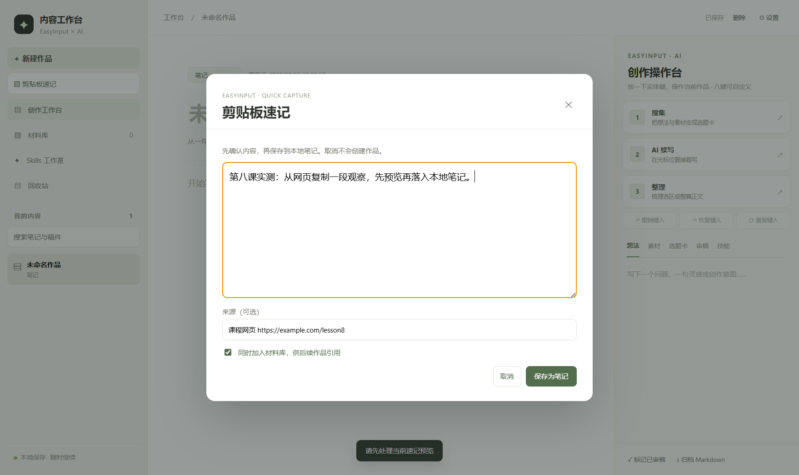
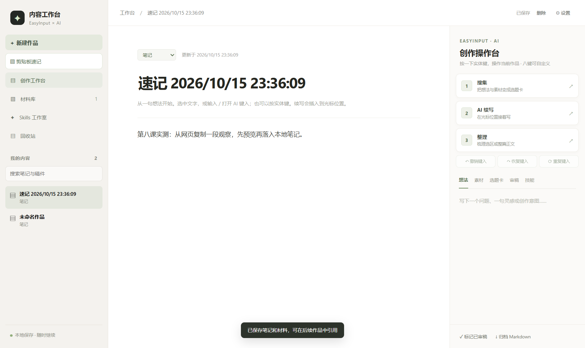
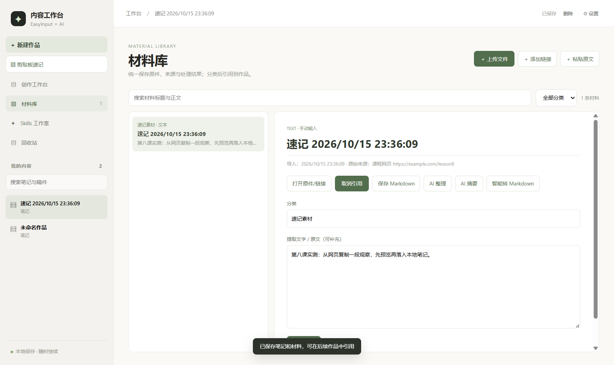

# 第八课作业：让 EasyInput 一键收集跨应用素材

**选择方向：方向一，在现有 EasyInput 八键开发板与第四课 AI 内容工作台上做功能延伸。** 第四课解决了“在一个工作台里写”，第八课补上“从其他应用采进来，并进入可复用的材料库”。交付包含源码、Windows 打包版验证、软件测试截图及一次实体 KEY4 联调记录。

## 摘要

我写 AI 产品经理内容时，常从网页、课程和聊天窗口摘取一段素材。第四课的工作台支持材料库和创作，但跨应用粘贴仍有多步操作，素材也容易只停留在一篇笔记里。我的延伸方案是让 EasyInput KEY4 唤起剪贴板预览，确认后保存本地笔记，并可同时生成有来源信息的材料记录，供后续作品引用。按键只是入口；是否保存、是否进材料库和来源写什么，仍由我决定。

## 1. 想法与真实场景

第四课做出的工作台已经能把 EasyInput 实体键映射到搜集、续写、整理等 AI 写作动作，也能保存笔记、材料、Skill 和审稿记录。我实际写文章时仍要经常从网页、课程资料或聊天窗口复制一小段观察，再切回工作台、新建笔记、粘贴、保存。这段跨应用采集流程频繁，而且复制内容可能包含无关文字，直接自动落盘容易把错误内容收进去。

因此第八课沿着一个场景延伸：**先复制，按一个实体键打开剪贴板预览，确认后存为速记，并按需纳入材料库。**面向正在收集写作素材的人，解决“采集步骤多、来源难追溯、后续找不到”的问题。它复用现有板子、USB HID 快捷键和工作台，没有重新画板、购买器件或改固件。

| 使用环节 | 原来怎样做 | 这次怎样做 |
| --- | --- | --- |
| 发现资料 | 复制后切回工作台、建笔记、粘贴 | 复制后按 KEY4，直接进入可编辑预览 |
| 核对来源 | 往往只记正文，之后回查出处 | 保存前可手填网页、课程或应用来源 |
| 复用素材 | 在笔记里找文字，再手动放进材料库 | 默认同时入材料库，笔记关联该材料；也可只留笔记 |

## 2. 方案、资料与选型

硬件是第四课已联调的 EasyInput AI 八键设备。设备按键通过现有配置发送 `Ctrl+Alt+Shift+1…8`，桌面工作台注册相同的全局快捷键，再按当前应用的键位映射执行动作。本次将**新安装用户**的 KEY4 默认动作设为“剪贴板速记（先预览）”；已经保存过八键映射的用户继续沿用原配置，可以在设置页自行把 KEY4 或其他键改为速记。实体键输出的快捷键协议保持不变，因此不需要重新烧录。侧栏按钮也可触发同一流程，便于没有设备时试用。

参照资料：[第八课作业指南](https://waytoagi.feishu.cn/wiki/Ar5hwqGkTiZTyskdp7ScE0TinAm)、[训练营主文档](https://waytoagi.feishu.cn/wiki/YUfhwbwdUiYXtYkCru7cfKaGnWb?chunked=false)、本项目[第四课实践报告](HOMEWORK-SUBMISSION.md)以及 EasyInput 设备[原有八键检测记录](artifacts/easyinput-hardware-check.json)。指南明确两条方向任选其一，方向一看现有板或工程上“加了/改了什么功能”，并建议软硬件协同、场景化设计、明确反馈与效果证据。

## 3. 实现过程

1. `lib/settings.cjs` 增加速记动作，并设为新安装用户的 KEY4 默认动作；读取已有 `settings.json` 时保留用户原键位。
2. `main.cjs` 收到 KEY4 对应的全局快捷键时读取系统剪贴板文字，再把内容发到工作台窗口；侧栏按钮通过 `preload.cjs` 读取剪贴板，进入同一个预览函数。
3. `renderer.js` 先打开可编辑预览。剪贴板为空或超过 20 万字符时提示且不建笔记；已有预览时再次按键不会覆盖正在编辑的内容。用户可填写最多 300 字的来源，例如网页链接或课程资料。
4. 用户确认后才生成带时间标题的本地笔记，保存正文、来源及“从剪贴板创建速记”历史记录。默认勾选“同时加入材料库”，会创建“速记素材”记录及 Markdown 副本，并将材料 ID 关联到笔记；取消勾选则仅存笔记。保存按钮处理期间禁用，避免连点产生重复笔记；取消则两处都不落盘。
5. 材料库同步发生在笔记保存之后；如果材料同步失败，已经保存的笔记仍保留，界面会明确提示。新笔记可继续使用第四课已有的整理、Skill、材料引用和归档功能。

数据保存在本机工作台数据目录。这个功能不自动调用 AI，也不自动发布复制内容。新笔记需要用户确认，有明确的成功提示；本次功能没有新增云端服务和硬件器件。快捷键由系统全局注册，其他程序占用同一组合键时，应在工作台设置页检查注册状态并调整冲突。

## 4. 验证与效果

软件验证在**独立测试数据目录**完成，未覆盖第四课真实作品。测试文字为“第八课实测：从网页复制一段观察，先预览再落入本地笔记。”：

| 验证动作 | 实际结果 |
| --- | --- |
| 新安装与已有设置 | 新安装默认 KEY4 为速记；已有八键设置保持原值 |
| 空白、超长剪贴板 | 均拦截，预览不打开，作品数保持 1 |
| 点击速记入口 | 预览框打开，显示剪贴板文字；作品数保持 1、材料数保持 0 |
| 预览期间再次触发 | 原正文及来源输入保持不变 |
| 取消预览 | 预览框关闭，作品数仍为 1、材料数仍为 0 |
| 再次打开、填写来源并连点保存 | 作品数只增加 1，材料数 0→1；笔记正文、来源和历史正确，材料原文、来源、Markdown 副本正确，材料 ID 已关联笔记 |
| 取消“同时加入材料库”后保存 | 再新增 1 篇笔记，材料数仍为 1，该笔记没有材料引用 |
| Windows 打包版 | 重新生成 `release-lesson8/win-unpacked/AI 内容工作台.exe`，用另一独立数据目录重复上述界面验证，结果一致 |
| 回归检查 | `npm test` 14 项通过；界面脚本与验证脚本通过 `node --check`；`git diff --check` 通过 |

第四课留下的硬件基线证据是：Windows 识别到 EasyInput，原程序报告配置同步成功，实体八键第二轮逐键测试每键各计一次，KEY3 在真实按键触发下完成一次“整理”。本次又在隔离的测试配置中把 KEY4 指向新动作，应用报告八个全局快捷键均已注册。2026 年 10 月 15 日，用户短按实体 KEY4 后**现场确认看到了“剪贴板速记”预览框，并点击保存**。测试目录作品数从 2 变为 3，新作品标题带时间，历史记录为“从剪贴板创建速记”；保存的正文是用户当时剪贴板中的 402 字，未对外展示。记录见[真机验证摘要](artifacts/lesson8-hardware-check.json)。这次是用户现场确认与应用落盘记录的组合证据；没有把旧的八键计数当成新功能结果，也没有声称记录到设备内部日志。增强版新增的来源输入与新默认键位已通过软件验证，真机联调发生在增强前的速记版本，因此不把真机结果说成新增来源输入的验证。

## 5. 调试、边界与下一步

开发时先用同一套入口连接按钮与实体键，避免两条路径出现不同的保存逻辑。第一版只生成笔记，我对照第四课的材料工作流后发现：笔记存下来了，后续写文章时却仍要手动再入库。这属于“采集成功、复用没完成”，于是加入材料库同步与笔记引用。用独立数据目录验证“取消两处都不落盘”“默认双存”“取消勾选只存笔记”，而不是只看弹窗能打开。预览可编辑，用户能在保存前删去复制内容中无关的文字。截图、自动测试和真实实体键各证明不同层面。

当前功能完成了软件实现、一次实体 KEY4 联调与来源追溯的基础设计。测试数据目录与真实作品分开；真机当时读到用户的实际剪贴板内容，而不是预设测试句子，因此报告只公开字符数和操作结果。真实按键联调证明了旧版“预览→笔记”；新增的材料库联动由软件测试证明，尚未再次请用户做实体键复测。

## 6. 产品经理视角：从采集速度走向素材复用

**产品判断：**下一步不应继续堆更多 AI 按钮，而应验证“采进来以后，能不能找得到、用得上”。这个功能的价值不是按键本身，而是降低跨应用采集成本，同时让素材在后续写作中可追溯、可复用。

### 6.1 目标用户与待完成任务

首要用户不是所有记笔记的人，而是在课程学习、产品研究或内容写作中，**经常从网页、文档和聊天窗口摘录材料，已经使用第四课工作台，并且愿意用 EasyInput 或快捷键的人**。

待完成任务可以表述为：“我在别的应用看到一段以后会用到的内容，希望尽快收进工作台，确认没有误复制，之后写作时还能找到并带着来源引用。”这比“做一个剪贴板功能”更能指导迭代，因为它同时覆盖采集、确认、找回和复用。

### 6.2 用户价值假设：和原有流程比较

| 对比项 | 原有方式 | 当前方案 | 仍需验证 |
| --- | --- | --- | --- |
| 采集 | 复制、切回工作台、新建笔记、粘贴并保存；之后可能还要手动加进材料库 | 复制后按 KEY4，检查可编辑预览，确认后创建笔记并可同步材料库 | 实际节省多少秒、是否真的少了操作 |
| 控制感 | 粘贴后才检查内容 | 保存前可编辑；取消不会落盘；可选择只存笔记 | 用户是否看懂“同时加入材料库” |
| 找回与复用 | 内容容易只在笔记中，或者要再次手动整理 | 材料进入第四课已有的搜索和引用流程，并关联当前笔记 | 用户能否快速搜到，之后是否真的引用 |
| 来源可信度 | 常常只保留正文 | 保存时可以填写来源 | 手动填来源是否过于麻烦，漏填后能否补录 |

本次实现已证明操作链路可以跑通，但尚未有足够的真实使用样本证明“效率提升”或“复用率提升”。产品价值假设是：**减少采集步骤、提高素材再利用概率，带来的收益高于键位设置、来源填写和误收内容所增加的成本。**目前只能确认前半段流程更短，具体耗时和长期复用效果仍要测量。

### 6.3 现有能力与真实缺口

第四课已有材料库、按标题/正文/链接/文件名搜索、分类筛选、引用到当前作品、AI 摘要和材料整理能力；第八课已补上 KEY4 速记预览、保存前编辑、笔记与材料关联及可选材料库同步。因此下一轮应补闭环短板，而不是重做已有功能。

| 观察到的缺口 | 用户影响 | 产品机会 |
| --- | --- | --- |
| 速记来源目前可在保存时填写，但材料详情没有修改来源的入口 | 忘记填写或写错后，来源信息难以补救 | 允许在材料详情补充、修正来源；来源不作为保存门槛 |
| 材料搜索覆盖正文、标题、链接和文件名，但没有覆盖速记保存的 source 字段 | 记得出处却搜不到材料，降低库内找回成功率 | 把来源纳入搜索，并显示匹配字段 |
| 没有跨笔记/材料的重复内容提醒 | 同一段素材多次复制会让材料库变乱 | 保存前提示相同或高度相似内容，允许打开旧记录、保留新来源或仍然新建 |
| 来源输入依赖手工填写 | 采集越快，越可能出现“正文有了、出处忘了” | 提供最近使用来源和常见来源类型的快捷选择；先不要求自动读取其他应用上下文 |

### 6.4 功能优先级与取舍

| 优先级 | 建议迭代 | 用户价值与成本判断 | 完成标准 |
| --- | --- | --- | --- |
| P0：先验证，不先加复杂功能 | 做一周真实使用记录，观察从复制到保存、取消、补来源、搜索和引用的完整路径 | 当前只有一次实体 KEY4 现场联调；先确认真实摩擦点，避免凭想象加功能 | 记录实际任务数、采集耗时、取消原因、来源填写情况和 7 天内引用情况；不记录剪贴板正文 |
| P1：下一轮开发 | 材料详情可编辑来源，材料搜索可命中 source | 改动范围小，直接补上来源遗漏后的补救与找回 | 保存后改来源，重新搜索可命中；普通材料的现有搜索行为回归正常 |
| P1：下一轮开发 | 本地重复素材提醒 | 降低材料库噪声；精确去重可以先用规范化文本做本地比对，不上传正文 | 相同内容出现时展示已有记录及来源；用户仍能选择保留新条目，不静默丢弃 |
| P1：用现有功能做可用性优化 | 检查“搜索材料 → 引用到当前作品”的入口是否足够顺手 | 引用能力已经存在，现阶段应先减少跳转、突出当前作品状态，而不是重造材料库 | 用户能在可用性测试中独立完成搜索并引用；引用后 AI 能读取关联材料 |
| P2：有数据再决定 | 浏览器辅助补充页面链接、批量采集或应用来源 | 可能减少手填，但需要浏览器扩展、授权和更多兼容维护 | 只有当来源漏填被观察为高频阻塞时才立项，并提供逐次确认和关闭入口 |
| 暂缓 | 自动读取前台应用、云同步、自动触发 AI 总结 | 会增加权限、隐私、同步冲突和运行成本；工作台已支持手动 AI 摘要，暂时没有证据证明这些能提高复用 | 先证明本地采集与检索本身形成稳定使用，再单独评估需求和成本 |

**下一次开发建议控制在两个小改动：来源可编辑并可搜索；保存前本地重复提醒。**搜索与引用继续复用第四课已有实现。OCR、自动读取前台应用、云同步和自动 AI 摘要暂不进入当前版本，避免把“素材进入工作台”扩展成权限和维护成本更高的产品。

### 6.5 指标与验证方式

北极星指标建议采用**7 天内被至少一个作品引用的速记材料占比**。它比“按了多少次键”更接近最终价值：素材不只是保存下来，还被实际用进作品。这个指标在样本很少时仅作方向性观察，不包装成显著结论。

辅助观察四个数：从打开预览到确认保存的比例、复制到保存的中位耗时、保存时来源填写比例、保存后 7 天内的材料引用比例。另记录取消、重复提醒出现次数和失败保存次数作为护栏。测试时只记录事件数量和耗时，不上传或记录剪贴板正文、链接或作品内容。

验证顺序：先用同一组典型素材分别走原有手动流程和 KEY4 流程，记录耗时与误操作；再连续一周观察真实材料是否被搜到和引用；最后邀请少量有类似写作/学习任务的人完成“采集—查找—引用”任务，记录他们卡住的位置。达到的结论应限于样本和场景，不把一次按键成功外推成长期效率提升。

结果驱动下一步：若采集很快但 7 天引用率低，优先改搜索与引用体验；若来源漏填多，优先做快捷来源和补录；若重复提醒频繁触发，再调整去重规则；若功能一周内很少触发，就先检查默认键位和目标场景，而不是继续增加 AI 能力。
## 7. 资料与文件

本地 Windows 打包版位于 `release-lesson8/win-unpacked/AI 内容工作台.exe`，未上传仓库。本文档供评审与复现，作业表单由作者本人决定是否以及何时提交。训练营主文档写明：2026 年 10 月 15 日 23:59 为优秀学员评选截止，10 月 26 日 23:59 为最晚作业提交时间。

## 附录｜代码与证据

- 完整源码：https://github.com/yingchao4399/ai-content-workbench/tree/lesson8-quick-capture
- 本作业报告：https://github.com/yingchao4399/ai-content-workbench/blob/lesson8-quick-capture/LESSON8-HOMEWORK.md
- 速记预览、保存结果、材料库截图：`artifacts/lesson8-quick-capture-preview.png`、`artifacts/lesson8-quick-capture.png`、`artifacts/lesson8-material-library.png`
- 真机联调摘要：`artifacts/lesson8-hardware-check.json`；软件流程验证：`scripts/verify-lesson8.cjs`
- 第八课作业指南：https://waytoagi.feishu.cn/wiki/Ar5hwqGkTiZTyskdp7ScE0TinAm
- 训练营主文档：https://waytoagi.feishu.cn/wiki/YUfhwbwdUiYXtYkCru7cfKaGnWb?chunked=false
- 本地运行：安装 Node.js 后执行 `npm ci`、`npm start`，点击“剪贴板速记”；EasyInput 用户可用 KEY4，或在设置页调整键位。验证脚本需要开启 9338 端口的 Chrome DevTools Protocol 和预置测试剪贴板句。
